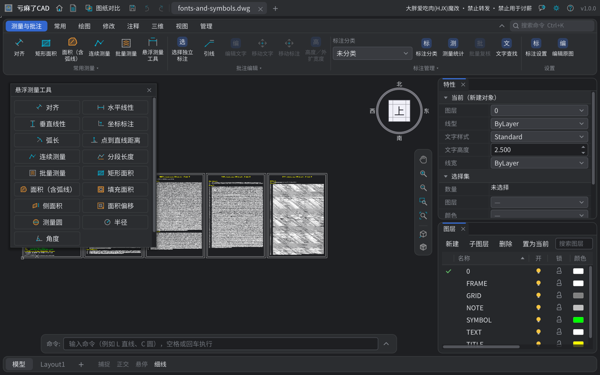

# 亏麻了CAD 1.0 新手指南

## 安装并打开第一张图

- **Windows x64** 双击同版本 Setup 安装程序，从开始菜单打开「亏麻了CAD」。老 Intel 集显遇到启动失败、花屏或操作缓慢时，可打开同一菜单中的「D3D11 兼容启动」。
- **Apple Silicon Mac** 解压应用 ZIP，将「LCQCAD.app」拖入「应用程序」。先保存并退出正在使用的旧版。新应用文件名是 LCQCAD.app，安装后可从「应用程序」打开它。
- 在首页打开 DWG 或 DXF。底部「模型」显示设计坐标中的图元，「布局」显示纸面和视口。看图用滚轮缩放，按住中键拖动平移。找不到图纸时点右侧导航的「全图」。

## 第一次测量一个房间

1. 切到「测量与批注」，打开「标注设置」确认原图模型单位。常见毫米图取毫米，米图取米。布局测量会读取视口比例。视口重叠时，在「工具与比例设置」明确选择要量的视口。
2. 先用「对齐」量一条已知长度，确认读数。需要额外校正时，在工具与比例设置中输入已知长度（米），点「两点校准」，再取对应两点。校准作用于当前模型或指定视口。
3. 矩形房间用「矩形面积」点两个对角。异形房间用「面积（含弧线）」沿内边界取点，点击起点或右键闭合。开启端点捕捉可以贴准图元端点。门窗洞口处按实际取量口径补齐边界。
4. 看到上方的放置提示后，移动鼠标，点一下把结果文字放在空白处。放字期间仍可缩放和平移。对齐与线性工具此时放置的是尺寸线。
5. 标注落下后会自动选中。在「标注特性」可修改备注、分类和编辑参数。需量侧面积时，选中该房间面积，再点「侧面积」，输入高度并回车，最后放字。侧面积按周长乘高度，门窗洞口需要另行核算。
6. 已命名图纸的测量会自动保存到本机。交接用「文件 → 另存为当前测量文件」，把同名 `.mcnotes` 和 DWG 放在一起。出现同目录文件冲突或图纸换版提示时，到「测量文件」预览后决定采用哪份。

## 连续、批量和统计

- **连续测量**沿路径取点。悬停圆弧中段，整段弧和两端点高亮后再点一下计入。靠近弧端点可继续按端点取点。若提示断开，先补取连接点。也可在开始前按 **O** 进入选段模式，把几段曲线相加。用 **A** 手工取三点弧，用 **L** 返回直线。回车后放置总长。
- **批量测量**先选图层，再点框的两个对角。「批量复核」能看每个来源实例。点图元排除或恢复，再回车和放字。曲线出框部分不计入，双线画法按实际两条线计算。
- **分类与统计**先建分类并设为当前，再新增测量，颜色会继承分类。已有记录可批量改分类。打开「测量统计」查看当前布局或整图，双击明细定位，导出 UTF-8 CSV 给同事。长度、周长、平面面积和侧面积分别汇总。模型和布局里各量一次会分别产生记录，整图汇总前先筛选。

| 操作 | 按键或鼠标 |
| --- | --- |
| 退回上一点或弧段 | 测量取点时按空格、Backspace 或 Ctrl/⌘+Z |
| 闭合面积 / 确认路径 | 右键或 Enter，随后进入放置 |
| 添加区域 / 扣孔 | 面积工具中按 C / H |
| 确认文字或尺寸线位置 | 左键，或在已预览位置右键 / Enter |
| 回到取点 / 取消测量 | 放置阶段按 Backspace / Esc |
| 打开常用命令菜单 | 画布空闲时右键 |
| 导出交接文件 | 文件 → 另存为当前测量文件 |
| 删除选中标注 | 空闲时按 Windows Delete 或 Mac 键盘的 Delete |
| 撤销提交 | 完成后 Ctrl/⌘+Z |

## 新旧图纸对比

1. 点顶部「图纸对比」，选已保存的旧版和新版。下拉框选择对应布局，或都选模型。
2. 坐标一致时直接用「叠图」。坐标有平移或旋转时点「两点对齐」，先在旧图依次点两个对应点，再在新版按同一顺序点。两图需要使用相同单位和尺度。
3. 绿色新增，红色删除，橙色与蓝色分别对应修改前后。点差异行定位。「匹配依据」说明疑似修改如何配对，必要时可以拆成删除和新增。
4. 在「覆盖范围」核对可比较图元数量及缺失外参、跳过对象。双方布局为空时换选有内容的布局。按图层或差异类型筛选后导出 CSV。

复杂天正对象、缺失外参、字体及部分多边形视口的显示需要结合原 CAD 复核。关键下料和结算前，可用已知尺寸和原版图纸核对数量。

[测量与批注工具详解](../macOS/MEASUREMENT-GUIDE.md)
